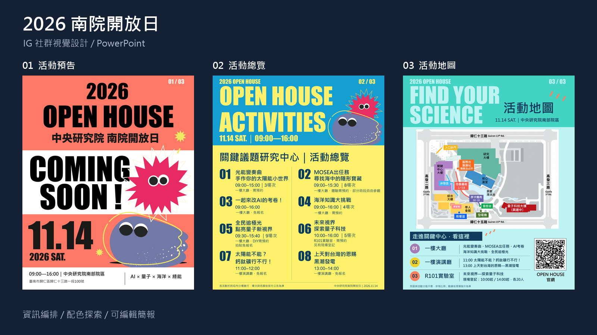
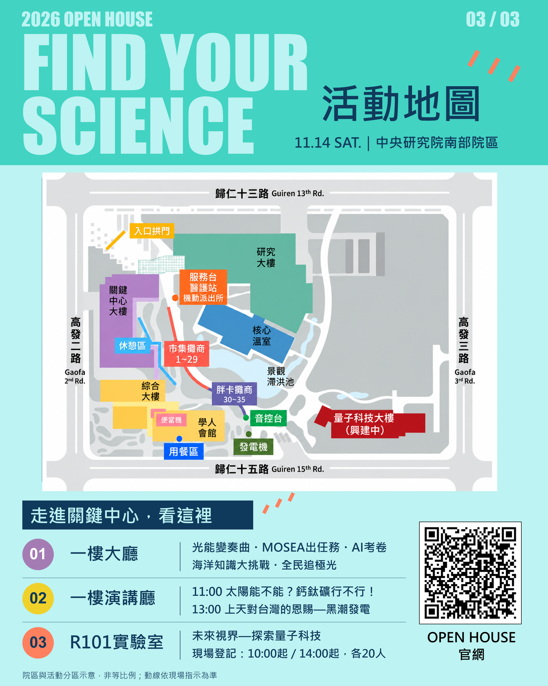

# 2026 中研院南院開放日｜IG 社群圖文視覺設計

**Academia Sinica South Campus Open House · Social Media & Carousel Design**



為中央研究院南部院區開放日（Open House）規劃的社群宣傳懶人包視覺作品。本專案將「活動預告」、「八項亮點科學活動」與「全區導覽地圖」系統化梳理為 Instagram 直式輪播圖（Carousel），兼顧社群瀏覽的高吸引力與資訊傳達的清晰度。

全案以原生 PowerPoint 向量物件重構，提供文字、色塊與標記均可自由調整的交付檔案，便於主辦團隊於活動前隨時微調場次與資訊。

---

## 📱 作品預覽（核心輪播三頁）

<table>
  <tr>
    <th width="33%">01｜Coming Soon</th>
    <th width="33%">02｜活動總覽</th>
    <th width="33%">03｜活動地圖</th>
  </tr>
  <tr>
    <td align="center">
      <br><br>
      <b>主視覺宣傳與日期公告</b><br>
      <sub>大字標題辨識主題，營造期待感</sub>
    </td>
    <td align="center">
      <br><br>
      <b>八大科學活動總覽</b><br>
      <sub>雙欄編排、時間序與報名預約條件</sub>
    </td>
    <td align="center">
      <br><br>
      <b>院區與館舍導覽地圖</b><br>
      <sub>建築空間、道路動線與活動入口 QR</sub>
    </td>
  </tr>
</table>

---

## 🎨 四款風格色系探索（Visual Palettes）

為符合不同社群受眾偏好與主題氛圍，設計初期探索了四組高辨識度色彩系統：

| 款式 | 配色名稱 | 主色調 | 視覺氛圍與應用亮點 |
| :---: | :--- | :--- | :--- |
| **D 款** | **湖水綠 × 深藍** | `#25B9AE` / `#103A5C` | 清新活力、現代科技感，凸顯空間導覽的明快節奏 |
| **B 款** | **深海藍 × 電光藍** | `#10284A` / `#63CFFF` | 沉穩專業、前沿學術感，加強夜間或社群暗色瀏覽對比 |
| **E 款** | **品牌藍 × 金黃** | `#087EAE` / `#FDBB28` | 活力熱情、高反差吸引力，強化標題與重點活動的聚焦點 |
| **O 款** | **橘紅 × 暖米白** | `#ED7766` / `#F7F4E9` | 溫暖親和、人文生活感，降低學術距離感，適合科普推廣 |

> 完整四款全 12 張風格圖檔已收錄於 [`previews/variants/`](previews/variants/) 資料夾中供對照查閱。

---

## ✨ 設計重點與思考

1. **IG 原生最佳閱讀比例（4:5）**
   - 採用直式 `1080 × 1350 px` 規格製作，匯出超高解析度 `2160 × 2700 px`，在手機滑動時佔滿螢幕最佳視野。
2. **高密度資訊的分級處理**
   - 梳理 8 大科學場次（演講、展覽、闖關、導覽工作坊），以「時間標籤 + 序號徽章 + 預約限制標示」建立即時掃讀動線。
3. **場域導覽動線化**
   - 繪製關鍵議題研究中心、量子研究中心、草坪活動區與周邊道路（大順七路、歸仁十三路），輔以官網 QR Code 引導即時報名。
4. **高自由度與交付彈性**
   - 捨棄純平面扁平輸出，文字方塊、重點色塊、向量裝飾皆可於 Microsoft PowerPoint 中直接選取編輯，免開專業排版軟體即可維護。

---

## 📂 專案結構

```text
github-portfolio/
├── README.md                      # 專案首頁說明（本文件）
├── .gitignore                     # Git 忽略設定
├── previews/                      # 高解析度展示圖檔
│   ├── cover.png                  # 作品集封面橫幅 (1600x900)
│   ├── 01-coming-soon.png         # 01 預告展示圖 (2160x2700)
│   ├── 02-event-overview.png      # 02 總覽展示圖 (2160x2700)
│   ├── 03-campus-map.png          # 03 地圖展示圖 (2160x2700)
│   └── variants/                  # 四款配色探索延伸圖檔 (共 12 張)
│       ├── D_01_ComingSoon.png ...
│       ├── B_01_ComingSoon.png ...
│       ├── E_01_ComingSoon.png ...
│       └── O_01_ComingSoon.png ...
├── downloads/                     # 交付與原始檔案
│   ├── open-house-social-design.pptx   # 可編輯 PowerPoint 原始檔
│   └── open-house-social-design.pdf    # 完整 3 頁作品展示 PDF
└── docs/                          # 設計與授權文件
    ├── design-notes.md            # 詳細設計理念與編輯指引
    └── credits.md                 # 素材來源與版權標註
```

---

## 💾 檔案下載

- 📝 **[可編輯 PowerPoint 檔案 (.pptx)](downloads/open-house-social-design.pptx)**（投影片內所有元素皆可選取修改）
- 📄 **[高解析度展示 PDF 檔 (.pdf)](downloads/open-house-social-design.pdf)**（保留跨裝置字型與排版外觀）
- 🖼️ **[高清圖檔預覽包 (.png)](previews/)**

---

## 🚀 GitHub 上傳教學（如何放上自己的作品集）

您可以透過以下兩種方式之一，將此資料夾上傳至您的 GitHub 帳號：

### 方式 A：透過 GitHub 網頁直接上傳（免安裝任何指令，最推薦）
1. 登入 [GitHub](https://github.com/)，點選右上角 **「+」** → **「New repository」**。
2. 填寫儲存庫名稱（例如：`academia-sinica-openhouse-design`），設為 **Public**，點擊 **Create repository**。
3. 在新頁面中點選 **「uploading an existing file」**。
4. 將 `github-portfolio` 資料夾內的所有檔案與資料夾拖曳進瀏覽器上傳。
5. 點擊下方綠色按鈕 **「Commit changes」**，即可在 GitHub 首頁看到完整的圖文展示！

### 方式 B：使用 Git 指令推送
若您的電腦已安裝 Git，可在終端機進入本資料夾執行：
```bash
cd github-portfolio
git init
git add .
git commit -m "feat: init open house social media portfolio"
git branch -M main
git remote add origin https://github.com/<您的GitHub帳號>/<儲存庫名稱>.git
git push -u origin main
```

---

## ℹ️ 備註與聲明

- 本專案用於個人設計作品展示。
- 專案中所引用的活動時間、場次內容及主視覺素材版權均歸中央研究院與原主辦單位所有。
- 詳細設計過程與編輯說明可參見 [`docs/design-notes.md`](docs/design-notes.md)。
